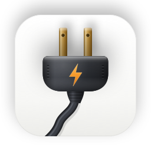

<p align="center"></p>

# PowerBoard

[中文](README.md) · [Methodology](docs/METHODOLOGY.md) · [Download](https://github.com/Kira-Calc/PowerBoard/releases)

> **Beta (0.1.0).** Features and the estimation model may still change.

PowerBoard is a macOS menu bar app that reads the local logs of Claude Code, Codex and Google Antigravity, counts tokens, and estimates how much electricity the providers' data centers used to answer them, with the carbon that produced it.

All numbers are estimates with a wide range. See [docs/METHODOLOGY.md](docs/METHODOLOGY.md) for how they are calculated and what they leave out.

## What it shows

- **Menu bar:** today's estimated inference energy (or tokens), with a dot for the server grid level when live grid data is connected.
- **Popover:** energy, carbon, tokens, everyday comparisons that rotate (each with a cited source), active conversations (click one to bring its terminal to the front), and per-tool totals.
- **Dashboard:** live overview with charts by tool, reports (day, week, month, year, year in review), per-record details, grid cleanliness, and settings.
- **Claude Code status line:** today's energy and carbon at the bottom of Claude Code, through the bundled `powerboard` command.
- **Exports:** CSV, JSON, Markdown, PNG and PDF, by hand or automatically into a folder.

Not covered: chats in claude.ai or the Claude desktop app. They write no local token logs.

## Requirements

macOS 14 or later, on Apple silicon or Intel.

## Install

The app is not signed with an Apple Developer ID or notarized, so macOS blocks it the first time.

**Download**

1. Download `PowerBoard-<version>.zip` from Releases and unzip it.
2. Move `PowerBoard.app` to `/Applications`.
3. Open it. When macOS says it cannot verify the developer, open **System Settings > Privacy & Security**, scroll down, and click **Open Anyway**.

   Or, in Terminal:

   ```bash
   xattr -dr com.apple.quarantine /Applications/PowerBoard.app
   ```

**Build from source**

Requires Xcode 16 or later and [XcodeGen](https://github.com/yonaskolb/XcodeGen).

```bash
git clone https://github.com/Kira-Calc/PowerBoard.git
cd PowerBoard
xcodegen generate
open PowerBoard.xcodeproj    # then run the PowerBoard scheme
```

To build the release zip (ad-hoc signed, universal) into `dist/`:

```bash
scripts/build-release.sh
```

## Terminal status line

**Claude Code:** turn on **Settings > Display > Show in Claude Code status line**, or run:

```bash
/Applications/PowerBoard.app/Contents/Helpers/powerboard install-statusline
```

This edits the `statusLine` entry of `~/.claude/settings.json` and backs the file up first. If you already have a status line, you can keep it and show both (`--combine`). `powerboard uninstall-statusline` restores the previous one.

**Codex** does not support custom status line commands yet. You can show the same line in tmux or iTerm2 instead. These examples have not been tested on every setup.

For convenience, link the command into your `PATH`:

```bash
ln -s /Applications/PowerBoard.app/Contents/Helpers/powerboard /usr/local/bin/powerboard
```

tmux, in `~/.tmux.conf`. `NO_COLOR=1` turns off terminal color codes, which tmux would print as text.

```tmux
set -g status-interval 30
set -g status-right '#(NO_COLOR=1 powerboard statusline --format compact < /dev/null)'
```

iTerm2 has no built-in component that runs a command, so use a small script. Enable **Settings > General > Magic > Enable Python API**, save the following as `~/Library/Application Support/iTerm2/Scripts/AutoLaunch/powerboard.py`, restart iTerm2, then add **PowerBoard** in **Settings > Profiles > Session > Configure Status Bar**.

```python
import asyncio
import os

import iterm2

POWERBOARD = "/Applications/PowerBoard.app/Contents/Helpers/powerboard"


async def main(connection):
    component = iterm2.StatusBarComponent(
        short_description="PowerBoard",
        detailed_description="Estimated AI inference energy today",
        knobs=[],
        exemplar="8.8 kWh | 2.5 kg",
        update_cadence=30,
        identifier="io.github.kira-calc.powerboard.statusbar",
    )

    @iterm2.StatusBarRPC
    async def powerboard(knobs):
        process = await asyncio.create_subprocess_exec(
            POWERBOARD, "statusline", "--format", "compact",
            stdin=asyncio.subprocess.DEVNULL,
            stdout=asyncio.subprocess.PIPE,
            env={**os.environ, "NO_COLOR": "1"},
        )
        output, _ = await process.communicate()
        return output.decode().strip()

    await component.async_register(connection, powerboard)


iterm2.run_forever(main)
```

## Command line

```bash
powerboard today                          # today's energy, carbon and tokens
powerboard today --json
powerboard report --period week           # Markdown report; also --format json or csv
powerboard report --period month --date 2026-09-15 --lang zh
powerboard statusline                     # one line, as used by Claude Code
```

Output is in English unless `--lang zh` is given or the language is changed in Settings.

## Grid cleanliness

Providers do not disclose where a request runs, so the app uses a few candidate data center locations per provider, taken from public reports.

- **Without an account:** each location's yearly average (US EPA eGRID) and the fossil-free share of the latest published day (US EIA, usually about one day late).
- **With a free WattTime account** (create or sign in on the Grid page): whether each grid is cleaner or less clean now than over its next 24 hours.
- **Optional:** an Electricity Maps API key adds live carbon intensity.

This is information only. The app never pauses, delays or schedules your work.

## Privacy

- Logs are read locally. The app reads token counts, model names, times, session IDs and project paths. It does not store conversation content. Active conversation titles are read from Claude Code's own title record to show in the list and are not stored.
- Data is stored in `~/Library/Application Support/PowerBoard/`. Settings > Data sources can delete it.
- Network requests go only to US EIA (fuel mix, no account), and to WattTime and Electricity Maps if you set them up. There is no analytics or telemetry.
- The WattTime password and Electricity Maps key are kept in the macOS Keychain.
- The only file outside its own folder that the app writes is `~/.claude/settings.json`, and only when you turn on the status line. It is backed up first.

## References

The energy factors, grid data and every everyday comparison are cited in [docs/METHODOLOGY.md](docs/METHODOLOGY.md#sources), and the Chinese [README](README.md#参考文献) lists the full bibliography.

## License

MIT. See [LICENSE](LICENSE). Energy factors are derived from [claude-carbon](https://github.com/gwittebolle/claude-carbon) (MIT). Other third-party notices are in [THIRD_PARTY_NOTICES.md](THIRD_PARTY_NOTICES.md).

